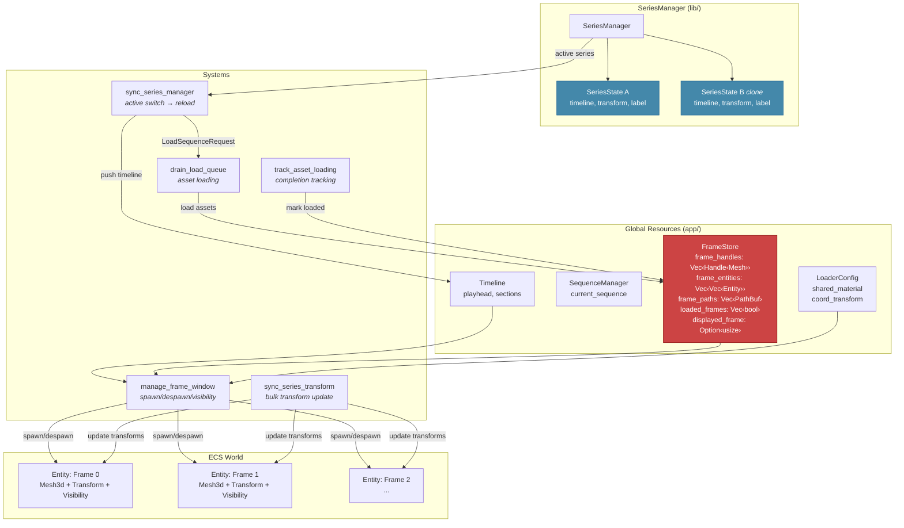
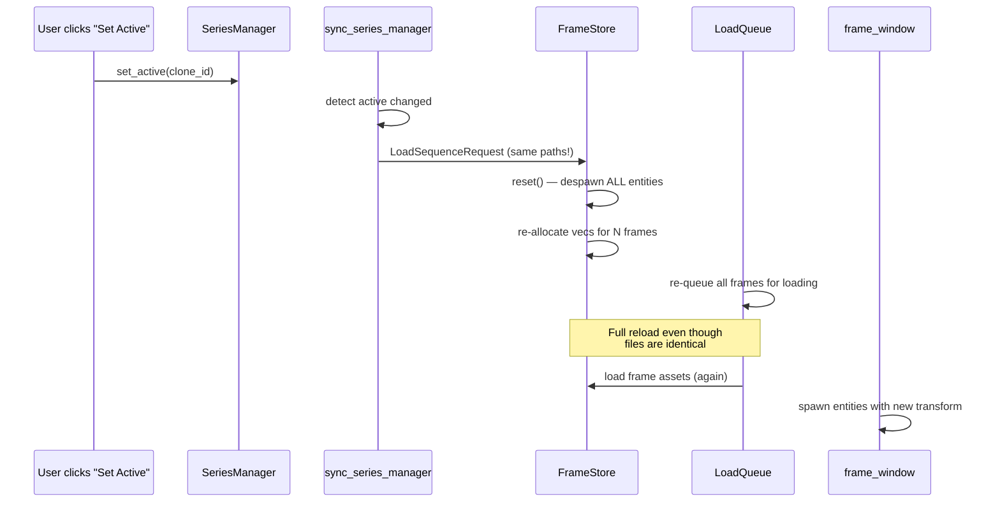
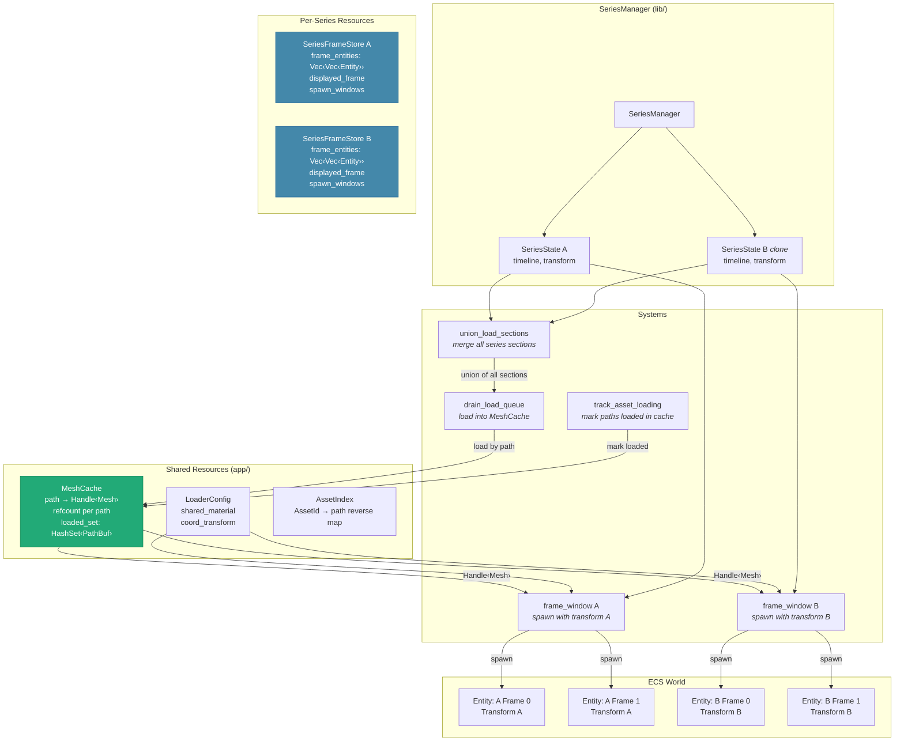
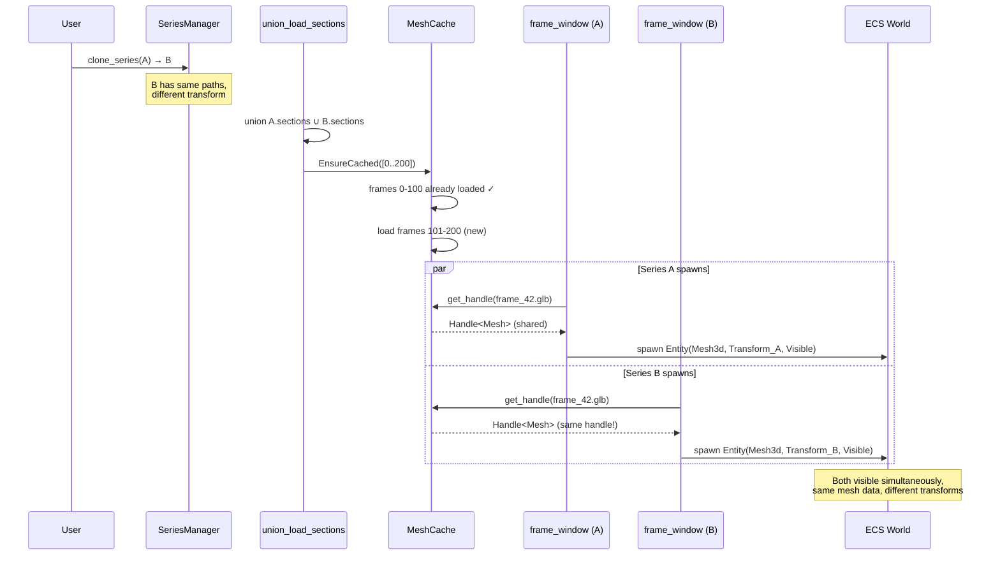

# FrameStore Architecture: Current → Projected

## Overview

This document describes the current single-series FrameStore architecture and the
projected multi-series architecture needed for simultaneous rendering of cloned/multiple
mesh series (seaview-5zf).

---

## Current Architecture

One global `FrameStore` resource owns everything: mesh handles, spawned entities,
loading state, and visibility. Only one series is rendered at a time.



### Problems

1. **Switching series = full reload.** Even between clone and original (same files),
   `handle_load_requests` calls `frame_store.reset()` and re-queues every frame.

2. **Only one series visible.** `FrameStore.frame_entities` is a single flat vec —
   there's no concept of "these entities belong to series A, those to series B."

3. **No handle sharing.** Two series pointing at the same `.glb` files load them
   independently. Same bytes, two `Handle<Mesh>` instances.

4. **Load sections are per-series, loading is global.** Series A wants frames [0-100],
   clone B wants [80-200], but only the active series' sections drive loading.

### Data Flow (Series Switch)



---

## Projected Architecture

Split `FrameStore` into two layers:

- **MeshCache** — shared, path-keyed, owns `Handle<Mesh>`. Load once.
- **SeriesFrameStore** — per-series, owns spawned `Entity` lists. Spawn per transform.



### Key Changes

| Aspect | Current | Projected |
|--------|---------|-----------|
| Mesh ownership | `FrameStore.frame_handles` (global, flat vec) | `MeshCache` (path-keyed HashMap) |
| Entity ownership | `FrameStore.frame_entities` (global, flat vec) | `SeriesFrameStore.frame_entities` (per-series) |
| Loading trigger | `LoadSequenceRequest` per series switch | `EnsureCached { paths }` — additive, no reset |
| Handle sharing | None — reload same file per switch | Shared by path — load once, clone handle |
| Visible series | One at a time | All simultaneously |
| Transform application | Global compose at spawn | Per-series compose at spawn |
| Load sections | Active series only | Union across all series |
| Series switch cost | Full reload (seconds) | Instant (spawn entities from cached handles) |

### Data Flow (Clone Visibility)



### Struct Sketches

```rust
/// Shared mesh handle cache — one Handle<Mesh> per file path.
/// Multiple series can reference the same handle.
#[derive(Resource)]
pub struct MeshCache {
    /// Canonical path → loaded mesh handle(s).
    /// Multi-mesh files (GLB) may have multiple handles per path.
    entries: HashMap<PathBuf, CacheEntry>,
}

struct CacheEntry {
    handles: Vec<Handle<Mesh>>,
    loaded: bool,
    /// Number of SeriesFrameStores referencing this path.
    refcount: usize,
    /// Estimated GPU bytes (for budget accounting).
    estimated_bytes: u64,
}

/// Per-series entity and visibility state.
/// Each series that should be renderable gets one of these.
#[derive(Debug)]
pub struct SeriesFrameStore {
    pub series_id: SeriesId,
    /// Spawned entities per frame index (None = not spawned).
    pub frame_entities: Vec<Option<Vec<Entity>>>,
    /// Currently displayed frame for this series.
    pub displayed_frame: Option<usize>,
    /// Frame paths (shared with MeshCache for lookups).
    pub frame_paths: Vec<PathBuf>,
    /// Total frames in this series.
    pub total_frames: usize,
}

/// Bevy resource holding all per-series frame stores.
#[derive(Resource, Default)]
pub struct SeriesFrameStores {
    stores: HashMap<SeriesId, SeriesFrameStore>,
}
```

---

## Migration Plan

### Phase 1: Introduce MeshCache (no behaviour change)

- Add `MeshCache` resource alongside existing `FrameStore`
- `drain_load_queue` populates both `FrameStore` (legacy) and `MeshCache`
- `track_asset_loading` marks loaded in both
- No per-series stores yet — `frame_window` still reads `FrameStore`
- **Result:** MeshCache exists and is populated, but not consumed. Safe, no breakage.

### Phase 2: Per-series entity stores

- Add `SeriesFrameStores` resource
- `manage_frame_window` iterates all series, spawns per-series entities from `MeshCache`
- Each series gets its own spawn window, transform, visibility
- Series switch = just adjust which timeline the UI controls (no reload)
- Remove entity fields from `FrameStore` (MeshCache owns handles, SeriesFrameStore owns entities)
- **Result:** Clones render simultaneously. Switching is instant.

### Phase 3: Union loading + budget

- `union_load_sections` system collects sections from all series, produces unified load set
- `drain_load_queue` loads the union into `MeshCache`
- Memory budget tracks `MeshCache` (shared) + per-series entity overhead
- Eviction: when a path's refcount drops to 0, it's eligible for cache eviction
- **Result:** Budget-aware multi-series rendering.

---

## Files Involved

| File | Current Role | Phase 1 | Phase 2 | Phase 3 |
|------|-------------|---------|---------|---------|
| `loader/assets.rs` | `FrameStore`, `LoaderConfig`, `AssetIndex` | + `MeshCache` | - entity fields from FrameStore | - |
| `loader/frame_window.rs` | Global spawn/despawn/visibility | unchanged | Per-series spawn loop | unchanged |
| `loader/load_queue.rs` | Queue frames → asset server | + populate MeshCache | reads union sections | union_load_sections |
| `loader/loading_tracker.rs` | Track asset completion | + mark MeshCache | unchanged | unchanged |
| `loader/mod.rs` | `handle_load_requests` | + init MeshCache | `EnsureCached` replaces full reset | budget integration |
| `sequence/mod.rs` | `sync_series_manager` | unchanged | no reload on switch | unchanged |
| `series.rs` | `SeriesManager`, `SeriesState` | unchanged | unchanged | unchanged |

---

## Related Issues

- **seaview-5zf** — This work (P1)
- **seaview-d33** — Clone series ✅ (data model done, rendering blocked on 5zf)
- **seaview-w5t** — Memory budget UI (Phase 3)
- **seaview-6pd** — Multi-series architecture ✅ (foundation)