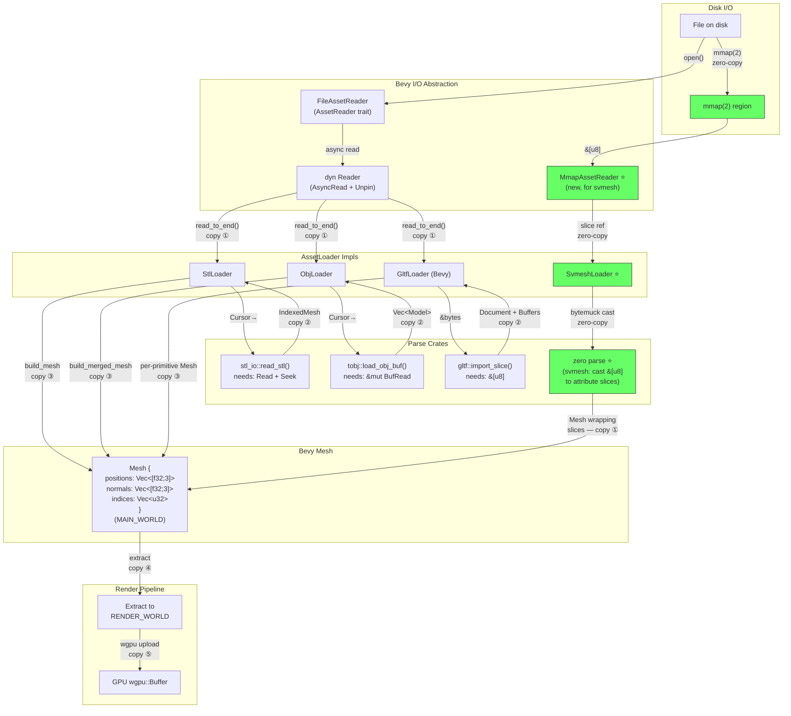
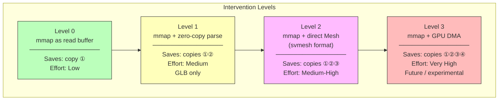
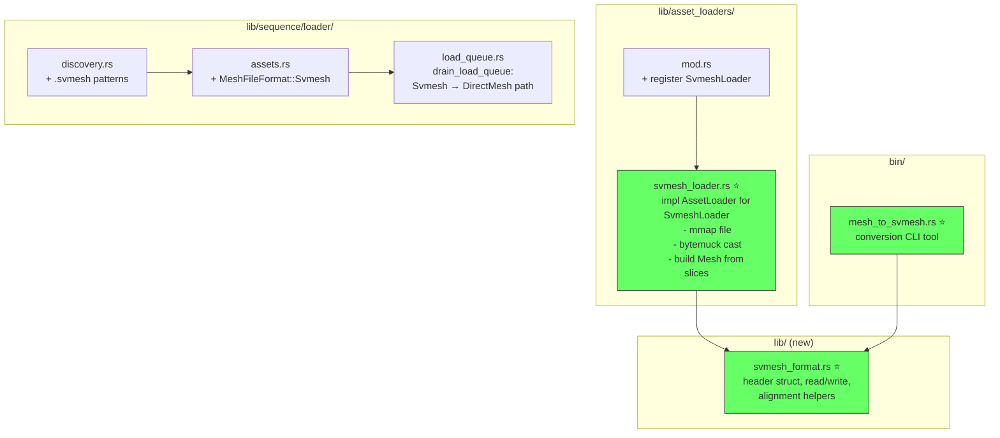

# mmap Loader Architecture — Research & Data Flow

> **Date**: 2026-02-16
> **Status**: Active research
> **Related issues**: seaview-joh (zero-copy mmap format), seaview-bdz.4 (MeshSource trait)
> **Depends on**: `mesh_loading_ecosystem.md`

## Table of Contents

1. [Current Data Flow — Every Byte Gets Copied](#current-data-flow--every-byte-gets-copied)
2. [Dependency Matrix — Format × Layer](#dependency-matrix--format--layer)
3. [Where mmap Can Intervene](#where-mmap-can-intervene)
4. [Copy Audit — Current Pipeline](#copy-audit--current-pipeline)
5. [mmap Strategy Options](#mmap-strategy-options)
6. [Custom svmesh Format Design](#custom-svmesh-format-design)
7. [Integration Points](#integration-points)
8. [Risks and Constraints](#risks-and-constraints)
9. [Recommendations](#recommendations)

---

## Current Data Flow — Every Byte Gets Copied

Every loader in the system follows the same pattern: read all bytes into a `Vec<u8>`,
parse into an intermediate representation, then build a Bevy `Mesh`. The Bevy `Mesh`
is then uploaded to GPU by the render extract system.

### STL Pipeline

```mermaid
graph LR
    subgraph Disk
        F1[".stl file"]
    end

    subgraph "Bevy I/O Layer"
        AR["AssetReader::read()
        (FileAssetReader)"]
        RD["Reader trait
        (async File)"]
    end

    subgraph "AssetLoader (our StlLoader)"
        R2E["reader.read_to_end()
        → Vec&lt;u8&gt; ①"]
        CUR["Cursor::new(&bytes)"]
        SIO["stl_io::read_stl()
        → IndexedMesh ②"]
        BM["build_mesh()
        → Bevy Mesh ③"]
    end

    subgraph "Bevy Asset System"
        AM["Assets&lt;Mesh&gt;
        (MAIN_WORLD)"]
    end

    subgraph "Bevy Render"
        EX["Extract to
        RENDER_WORLD ④"]
        GPU["GPU Buffer ⑤"]
    end

    F1 -->|"syscall read()"| AR
    AR --> RD
    RD -->|"async read"| R2E
    R2E --> CUR --> SIO
    SIO -->|"clone verts + indices"| BM
    BM --> AM
    AM -->|"RenderAssetUsages"| EX
    EX -->|"wgpu upload"| GPU

    style R2E fill:#f96,stroke:#333
    style SIO fill:#f96,stroke:#333
    style BM fill:#f96,stroke:#333
    style EX fill:#f96,stroke:#333
```



### OBJ Pipeline

```mermaid
graph LR
    subgraph Disk
        F2[".obj file"]
    end

    subgraph "Bevy I/O Layer"
        AR2["AssetReader::read()"]
        RD2["Reader trait"]
    end

    subgraph "AssetLoader (our ObjLoader)"
        R2E2["reader.read_to_end()
        → Vec&lt;u8&gt; ①"]
        CUR2["Cursor::new(&bytes)"]
        TOBJ["tobj::load_obj_buf()
        → Vec&lt;Model&gt; ②"]
        TRI["triangulate +
        single_index merge"]
        BM2["build_merged_mesh()
        → Bevy Mesh ③"]
    end

    subgraph "Bevy Asset System"
        AM2["Assets&lt;Mesh&gt;
        (MAIN_WORLD)"]
    end

    subgraph "Bevy Render"
        EX2["Extract ④"]
        GPU2["GPU Buffer ⑤"]
    end

    F2 --> AR2 --> RD2 -->|"async read"| R2E2
    R2E2 --> CUR2 --> TOBJ --> TRI --> BM2
    BM2 --> AM2 --> EX2 --> GPU2

    style R2E2 fill:#f96,stroke:#333
    style TOBJ fill:#f96,stroke:#333
    style BM2 fill:#f96,stroke:#333
    style EX2 fill:#f96,stroke:#333
```



### GLB Pipeline (two-phase)

```mermaid
graph LR
    subgraph Disk
        F3[".glb file"]
    end

    subgraph "Bevy I/O Layer"
        AR3["AssetReader::read()"]
        RD3["Reader trait"]
    end

    subgraph "Bevy GltfLoader"
        R2E3["reader.read_to_end()
        → Vec&lt;u8&gt; ①"]
        GLTF["gltf::import_slice()
        → Document + Buffers ②"]
        PRIM["per-primitive:
        build Bevy Mesh ③"]
    end

    subgraph "Bevy Asset System"
        AG["Assets&lt;Gltf&gt;"]
        AGM["Assets&lt;GltfMesh&gt;"]
        AM3["Assets&lt;Mesh&gt;
        (MAIN_WORLD)"]
    end

    subgraph "Our Loader"
        EGM["extract_gltf_meshes()
        → Vec&lt;Handle&lt;Mesh&gt;&gt;"]
    end

    subgraph "Bevy Render"
        EX3["Extract ④"]
        GPU3["GPU Buffer ⑤"]
    end

    F3 --> AR3 --> RD3 --> R2E3
    R2E3 --> GLTF --> PRIM
    PRIM --> AM3
    PRIM --> AGM --> AG
    AG -->|"LoadedWithDependencies"| EGM
    EGM -->|"collect handles"| AM3
    AM3 --> EX3 --> GPU3

    style R2E3 fill:#f96,stroke:#333
    style GLTF fill:#f96,stroke:#333
    style PRIM fill:#f96,stroke:#333
    style EX3 fill:#f96,stroke:#333
```



### Legend

Orange nodes (①–⑤) are **allocation + copy** steps:

| # | What happens | Typical size (5M vert mesh) |
|---|-------------|----------------------------|
| ① | `read_to_end` — kernel → userspace heap | 60–240 MB (file size) |
| ② | Parse crate builds its own data structures | 60–120 MB (positions + indices + normals) |
| ③ | Build Bevy `Mesh` attribute vecs | ~80 MB (pos + normal + indices) |
| ④ | Extract copies `Mesh` data to render world staging | ~80 MB |
| ⑤ | wgpu uploads to GPU VRAM | ~80 MB |

**Total CPU memory at peak for one frame: ~300–500 MB** for a 5M vertex mesh, with 3–4 copies of the vertex data alive simultaneously.

---

## Dependency Matrix — Format × Layer

```
┌─────────────┬──────────────────┬───────────────────┬──────────────────┬──────────────┐
│ Layer       │ STL              │ OBJ               │ GLB/glTF         │ svmesh (fut.)│
├─────────────┼──────────────────┼───────────────────┼──────────────────┼──────────────┤
│ Disk I/O    │ Bevy FileAsset-  │ Bevy FileAsset-   │ Bevy FileAsset-  │ mmap(2)      │
│             │ Reader (seq://)  │ Reader (seq://)   │ Reader (seq://)  │ direct       │
├─────────────┼──────────────────┼───────────────────┼──────────────────┼──────────────┤
│ Byte source │ Reader::read_to_ │ Reader::read_to_  │ Reader::read_to_ │ &[u8] from   │
│             │ end → Vec<u8>    │ end → Vec<u8>     │ end → Vec<u8>    │ mmap region  │
├─────────────┼──────────────────┼───────────────────┼──────────────────┼──────────────┤
│ Parse crate │ stl_io 0.7       │ tobj 4.0          │ gltf 1.4         │ none (raw)   │
│             │ read_stl()       │ load_obj_buf()    │ import_slice()   │              │
│             │ → IndexedMesh    │ → Vec<Model>      │ → Document+Buf   │              │
├─────────────┼──────────────────┼───────────────────┼──────────────────┼──────────────┤
│ Intermediate│ IndexedMesh {    │ Model.mesh {      │ Accessor →       │ none         │
│ repr        │   vertices,      │   positions,      │   buffer views → │              │
│             │   faces          │   normals,        │   typed slices   │              │
│             │ }                │   texcoords,      │                  │              │
│             │                  │   indices }       │                  │              │
├─────────────┼──────────────────┼───────────────────┼──────────────────┼──────────────┤
│ Triangulate │ already tris     │ tobj triangulate  │ already tris     │ already tris │
│             │                  │ (fan, at parse)   │ (glTF spec)      │ (pre-baked)  │
├─────────────┼──────────────────┼───────────────────┼──────────────────┼──────────────┤
│ Index merge │ already indexed  │ tobj single_index │ already single   │ already      │
│             │                  │ (at parse)        │ indexed          │ indexed      │
├─────────────┼──────────────────┼───────────────────┼──────────────────┼──────────────┤
│ Normal gen  │ accumulate face  │ Bevy compute_     │ from glTF data   │ pre-computed │
│             │ normals per vert │ normals() if      │ (usually present)│              │
│             │                  │ missing           │                  │              │
├─────────────┼──────────────────┼───────────────────┼──────────────────┼──────────────┤
│ Mesh build  │ Mesh::new() +   │ Mesh::new() +     │ Bevy GltfLoader  │ Mesh::new()  │
│             │ with_inserted_   │ with_inserted_    │ builds per       │ wrapping mmap│
│             │ attribute()      │ attribute()       │ primitive        │ slices       │
├─────────────┼──────────────────┼───────────────────┼──────────────────┼──────────────┤
│ AssetLoader │ our StlLoader    │ our ObjLoader     │ Bevy GltfLoader  │ our Svmesh-  │
│ impl        │                  │                   │                  │ Loader       │
├─────────────┼──────────────────┼───────────────────┼──────────────────┼──────────────┤
│ Asset type  │ Handle<Mesh>     │ Handle<Mesh>      │ Handle<Gltf> →   │ Handle<Mesh> │
│             │                  │                   │ Handle<Mesh>     │              │
├─────────────┼──────────────────┼───────────────────┼──────────────────┼──────────────┤
│ Copies to   │ 4 (read, parse,  │ 4 (read, parse,  │ 4+ (read, parse, │ 1–2 (mmap →  │
│ GPU         │ mesh, extract)   │ mesh, extract)    │ mesh, extract)   │ mesh/extract)│
├─────────────┼──────────────────┼───────────────────┼──────────────────┼──────────────┤
│ mmap viable │ ❌ format not    │ ❌ format not     │ ❌ format not    │ ✅ designed  │
│ at I/O layer│ memory-mappable  │ memory-mappable   │ memory-mappable  │ for mmap     │
├─────────────┼──────────────────┼───────────────────┼──────────────────┼──────────────┤
│ mmap viable │ ❌ stl_io needs  │ ❌ tobj needs     │ ⚠️ gltf crate   │ ✅ no parse  │
│ at parse    │ Read+Seek        │ BufRead           │ can use &[u8]    │ needed       │
│ layer       │                  │                   │ (import_slice)   │              │
└─────────────┴──────────────────┴───────────────────┴──────────────────┴──────────────┘
```

### As a Mermaid dependency graph



---

## Where mmap Can Intervene

There are **four possible intervention points**, from least to most ambitious:

### Level 0: mmap as read buffer (trivial, limited benefit)

Replace `read_to_end() → Vec<u8>` with `mmap` to get a `&[u8]` without a heap copy.
The parse crate still copies everything into its own structures.

- **Eliminates**: Copy ① (kernel → userspace heap alloc)
- **Keeps**: Copies ②③④⑤
- **Benefit**: ~60–240 MB less peak RSS per frame
- **Difficulty**: Low — custom `AssetReader` returning mmap-backed `Reader`
- **Applicable to**: GLB (gltf crate accepts `&[u8]`), STL/OBJ with wrapper

### Level 1: mmap + zero-copy parse (moderate, format-specific)

Use mmap'd `&[u8]` and a parser that borrows from it rather than allocating.
The `gltf` crate's `import_slice()` partially does this — it references buffer
data by offset rather than cloning it. But Bevy's `GltfLoader` still copies
when building `Mesh` attributes.

- **Eliminates**: Copies ①②
- **Keeps**: Copies ③④⑤
- **Benefit**: Significant RSS reduction, faster parse
- **Difficulty**: Medium — need to audit `gltf` crate's actual copy behavior
- **Applicable to**: GLB only (STL/OBJ parse crates own their output)

### Level 2: mmap + direct Mesh construction (ambitious, our format only)

Design `svmesh` so the on-disk byte layout matches Bevy `Mesh` attribute
layout exactly. `mmap` the file, cast byte slices to `[f32; 3]` and `u32`
via `bytemuck`, build `Mesh` attribute vecs from these (one memcpy from
mmap pages to heap `Vec`).

- **Eliminates**: Copies ①②, minimizes ③
- **Keeps**: Copies ④⑤ (Bevy render extract + GPU upload are mandatory)
- **Benefit**: Near-instant "parse" — limited only by page fault I/O
- **Difficulty**: Medium-high — custom format design, alignment constraints
- **Applicable to**: svmesh only

### Level 3: mmap + GPU DMA (theoretical, future)

Map the file into the GPU's address space directly (if hardware supports it),
skipping CPU copies entirely. Requires `wgpu` support for importing external
memory, or Vulkan-specific extensions (`VK_EXT_external_memory_host`).

- **Eliminates**: Copies ①②③④
- **Keeps**: Only ⑤ (and even that becomes a map, not a copy)
- **Benefit**: Theoretical optimum — file on disk IS the GPU buffer
- **Difficulty**: Very high — needs wgpu changes, driver support, alignment
- **Applicable to**: svmesh only, specific GPU vendors



---

## Copy Audit — Current Pipeline

### Per-frame memory lifecycle (5M vertex STL, ~240 MB file)

```
Time →
        read_to_end    stl_io parse    build Mesh    extract    upload
        ┌──────────┐
  ①     │ Vec<u8>  │   (240 MB file bytes)
        │  240 MB  │
        └──────┬───┘
               │    ┌──────────┐
  ②            └──→ │IndexedMesh│   (verts: 60 MB, faces: 60 MB)
                    │  120 MB  │
                    └──────┬───┘
                           │    ┌──────────┐
  ③                        └──→ │ Bevy Mesh│   (pos: 60 MB, norm: 60 MB, idx: 20 MB)
                                │  ~140 MB │
                                └──────┬───┘
                                       │
           Vec<u8> dropped ────────────┤   (240 MB freed)
           IndexedMesh dropped ────────┤   (120 MB freed)
                                       │
                                       │    ┌──────────┐
  ④                                    └──→ │ Extract  │   (clone Mesh data)
                                            │  ~140 MB │
                                            └──────┬───┘
                                                   │    ┌──────────┐
  ⑤                                                └──→ │ GPU Buf  │   (VRAM)
                                                        │  ~80 MB  │
                                                        └──────────┘

  Peak RSS: 240 + 120 + 140 = ~500 MB (before drops)
  Steady:   140 MB (Mesh in MAIN_WORLD, if kept for spatial queries)
            + 80 MB VRAM
```

### What svmesh eliminates

```
Time →
        mmap           bytemuck cast    Mesh wrap      extract    upload
        ┌──────────┐
  mmap  │ &[u8]    │   (140 MB, kernel page cache — NOT RSS until touched)
        │  0 RSS   │
        └──────┬───┘
               │    ┌──────────┐
  cast         └──→ │ &[[f32;3]]│   (zero-copy reinterpret)
                    │  0 alloc │
                    └──────┬───┘
                           │    ┌──────────┐
  wrap                     └──→ │ Bevy Mesh│   (.to_vec() — one copy)
                                │  ~140 MB │
                                └──────┬───┘
                                       │    ┌──────────┐
  ④                                    └──→ │ Extract  │
                                            │  ~140 MB │
                                            └──────┬───┘
                                                   │    ┌──────────┐
  ⑤                                                └──→ │ GPU Buf  │
                                                        │  ~80 MB  │
                                                        └──────────┘

  Peak RSS: 140 MB (one copy for Bevy Mesh vecs, mmap pages lazy-loaded)
  Steady:   140 MB + 80 MB VRAM (same as before, but got here 10x faster)
```

**Key win**: Peak RSS drops from ~500 MB to ~140 MB per frame. Parse time
drops from hundreds of ms to near-zero (page faults only, handled by kernel).

---

## Custom svmesh Format Design

### File layout (strawman)

```
Offset  Size     Field
──────  ───────  ─────────────────────────────────
0x00    8        Magic: "SVMESH\0\0"
0x08    4        Version: u32 (1)
0x0C    4        Flags: u32 (has_normals, has_uvs, has_colors)
0x10    4        vertex_count: u32
0x14    4        index_count: u32
0x18    4        positions_offset: u32 (byte offset from file start)
0x1C    4        normals_offset: u32 (0 if no normals)
0x20    4        uvs_offset: u32 (0 if no UVs)
0x24    4        indices_offset: u32
0x28    4        padding / reserved
0x2C    4        checksum: u32 (optional, CRC32 of data region)
──────  ───────  ─────────────────────────────────
0x30    N×12     positions: [f32; 3] × vertex_count     (16-byte aligned)
...     N×12     normals:   [f32; 3] × vertex_count     (16-byte aligned)
...     N×8      uvs:       [f32; 2] × vertex_count     (16-byte aligned, optional)
...     M×4      indices:   u32       × index_count      (4-byte aligned)
```

### Design constraints

| Constraint | Reason |
|-----------|--------|
| Attributes stored as contiguous, typed arrays | `bytemuck::cast_slice` needs contiguous same-type data |
| 16-byte alignment for each section | GPU buffer alignment, SIMD-friendly |
| Little-endian | x86/ARM native, GPU native, no byte-swap needed |
| No compression | mmap requires seekable, fixed-offset access |
| Pre-triangulated | No parse-time work |
| Pre-indexed, single-index | Matches Bevy Mesh exactly |
| Pre-computed normals | No runtime normal computation |

### Conversion tool

A `bin/stl_to_svmesh` (or generalized `mesh_to_svmesh`) CLI tool:

```
input.stl → StlLoader → Mesh → svmesh writer → output.svmesh
input.obj → ObjLoader → Mesh → svmesh writer → output.svmesh
input.glb → GltfLoader → Mesh → svmesh writer → output.svmesh
```

This is offline, one-time cost. Sequences of N frames become N `.svmesh` files.

---

## Integration Points

### Where svmesh touches existing code



### Files that change

| File | Change | Size |
|------|--------|------|
| `lib/asset_loaders/svmesh_loader.rs` | **New** — AssetLoader impl with mmap | ~150 lines |
| `lib/asset_loaders/mod.rs` | Register SvmeshLoader | 3 lines |
| `lib/svmesh_format.rs` | **New** — header, read, write, alignment | ~200 lines |
| `lib/sequence/loader/assets.rs` | Add `MeshFileFormat::Svmesh` variant | 10 lines |
| `lib/sequence/loader/load_queue.rs` | `Svmesh` in direct-mesh match arm | 1 line |
| `lib/sequence/discovery.rs` | `.svmesh` sequence patterns | 6 lines |
| `bin/mesh_to_svmesh.rs` | **New** — offline conversion tool | ~150 lines |
| `Cargo.toml` | `memmap2` dependency | 1 line |

### Files that DON'T change

| File | Why |
|------|-----|
| `loading_tracker.rs` | Svmesh uses DirectMesh path — same `AssetEvent<Mesh>` handling |
| `frame_window.rs` | Format-agnostic entity spawning |
| `spatial_index.rs` | `SpatialMesh::from_bevy_mesh()` works on any `Mesh` |
| `mod.rs` (loader) | `load_direct_mesh_handle` already handles any direct-mesh format |
| UI systems | Format-agnostic |

---

## Risks and Constraints

### mmap caveats on Linux

| Risk | Mitigation |
|------|-----------|
| Page faults stall the thread | Load is async; page faults only block the asset-loading thread, not the main/render thread. Kernel readahead (`madvise(MADV_SEQUENTIAL)`) prefetches pages. |
| File modified while mapped | We don't modify sequence files. Read-only mapping. |
| 32-bit address space exhaustion | Not applicable — we target 64-bit only. |
| THP (Transparent Huge Pages) | Beneficial for large sequential reads. No action needed. |
| NFS / network filesystem | mmap over NFS is fragile. Document "local disk only" for svmesh. |
| `memmap2` vs `mmap2` syscall | `memmap2` crate is the maintained fork of `memmap`. Safe Rust wrapper. |

### Bevy Mesh ownership

Bevy's `Mesh` stores attribute data in owned `Vec`s. There is no way to give it
a borrowed slice — it must own the data. This means **one copy is unavoidable**:
mmap `&[u8]` → `.to_vec()` → `Mesh` attribute. This is the "Level 2" floor.

To eliminate this copy (Level 3), we'd need either:
- A Bevy PR to support `Cow<[u8]>` or borrowed attribute data in `Mesh`
- A custom render pipeline that bypasses `Mesh` entirely and creates `wgpu::Buffer` from mmap
- Both are significant undertakings and not worth pursuing until Level 2 proves its value

### Endianness

All target platforms (x86_64, aarch64) are little-endian. wgpu buffer uploads
expect native endianness. No byte-swapping needed. The svmesh format is defined
as little-endian; big-endian platforms would need conversion (but we don't
target any).

---

## Recommendations

### Phase 1: svmesh format + loader (Level 2)

This is the sweet spot — maximum benefit, reasonable effort:

1. **Define svmesh format** in `lib/svmesh_format.rs` — header + contiguous typed arrays
2. **Write SvmeshLoader** — `mmap` via `memmap2`, `bytemuck::cast_slice`, `.to_vec()` into Mesh attributes
3. **Write conversion tool** — `bin/mesh_to_svmesh.rs`, reads any supported format, writes svmesh
4. **Add to format detection** — `MeshFileFormat::Svmesh`, discovery patterns, load queue
5. **Benchmark** — compare load time and peak RSS vs STL/GLB for a 100-frame sequence

**Expected results** for a 5M vertex, 100-frame sequence:
- Load time per frame: ~5ms (mmap + memcpy) vs ~300ms (STL parse) or ~150ms (GLB parse)
- Peak RSS per frame: ~140 MB vs ~500 MB
- Sequence swap speed: effectively instant (kernel page cache handles prefetch)

### Phase 2: mmap-backed AssetReader (Level 0)

Separately, implement a generic `MmapAssetReader` that replaces `FileAssetReader` for
the `seq://` source. This benefits ALL formats (STL, OBJ, GLB) by eliminating copy ①:

- `AssetReader::read()` returns an mmap-backed `Reader` instead of `File`
- `read_to_end()` becomes a no-op (the "Vec" is backed by mmap pages)
- Parse crates still copy, but we avoid the initial heap allocation

This is orthogonal to svmesh and can be done independently.

### Phase 3: Evaluate Level 3 (future)

Only after Level 2 is proven and profiled. Requires:
- Vulkan external memory import investigation
- wgpu feature request / PR
- Custom render pipeline bypassing `Mesh`
- Probably not worth it until we hit >10M vertices per frame at 60fps

---

## References

- `memmap2` crate: https://crates.io/crates/memmap2 (maintained fork of `memmap`)
- `bytemuck`: already in our deps, `cast_slice` for zero-copy reinterpret
- Bevy `AssetReader` trait: `vendor/bevy/crates/bevy_asset/src/io/mod.rs`
- Bevy `Mesh` attribute storage: `vendor/bevy/crates/bevy_mesh/src/mesh.rs` (owned `Vec` only)
- `madvise(2)`: `MADV_SEQUENTIAL` for readahead, `MADV_WILLNEED` for prefetch
- Linux page cache: mmap'd files share the kernel page cache with `read()` — no double caching
- Existing format research: `docs/research/mesh_formats_comparison.md`
- Ecosystem research: `docs/research/mesh_loading_ecosystem.md`
- Spatial queries research: `research/spatial_queries.md`
